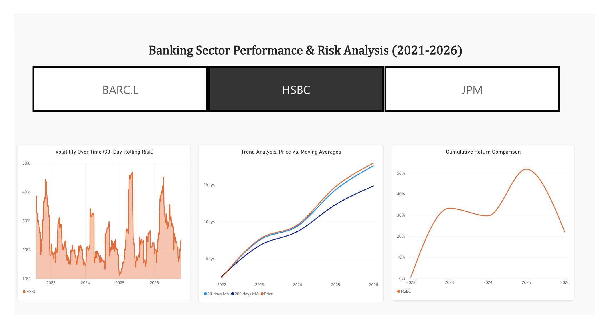

# Banking-Sector-Stock-Market-Analysis
## Overview
A quantitative data analysis project focused on evaluating the performance and risk metrics of major global banks (HSBC, JPM, Barclays). This project demonstrates an end-to-end data pipeline: extracting financial data via the Yahoo Finance API, engineering quantitative features in Python, and visualizing investment insights through an interactive Power BI dashboard.

## Tech Stack
* **Python:** `pandas`, `numpy`, `yfinance`, `datetime`
* **Data Visualization:** Power BI
* **Domain Knowledge:** Time Series Analysis, Risk-Reward Metrics, Moving Averages, Volatility, Asset Correlation

## Key Features & Methodology
1. **Automated ETL & Data Cleaning:** Extracted historical stock data and resolved calendar/timezone discrepancies between US and UK stock exchanges to ensure exact alignment for rolling calculations.
2. **Quantitative Feature Engineering:** Calculated key financial metrics, including:
   * Logarithmic returns
   * Annualized rolling volatility (30-day window)
   * 30-day and 200-day Moving Averages (MA)
   * Cumulative returns
3. **Business Insights & Risk Assessment:** Aggregated total returns and average volatility to identify the highest yield and risk assets. Generated a correlation matrix to assess portfolio diversification potential.
4. **Interactive Dashboard:** Designed a Power BI dashboard featuring dynamic slicers to visualize cumulative returns, price trends against moving averages, and volatility spikes over time.

## Dashboard Preview

## Repository Structure
* `banking_analysis.py`: Main Python script for data extraction, metric calculation, and CSV export.
* `banking_stocks_analysis.csv`: Cleaned and processed dataset.
* `banking_stocks_analysis.pbix`: Power BI file containing the interactive report.
* `dashboard.png`: Static snapshot of the final visualization of one bank.
